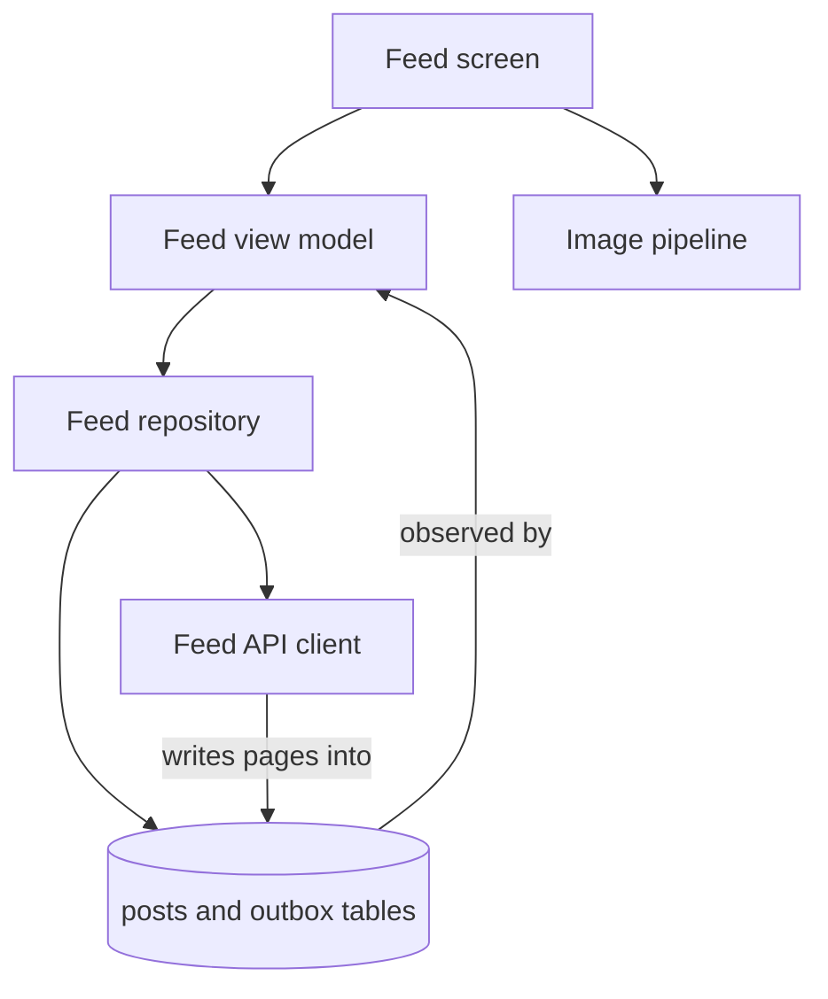

# Design a News Feed App

The feed is the most common mobile design question. The client shows a scrolling list of posts with images, and the user can like a post. The two hard parts are paging through a list that changes while the user reads it, and showing useful content with no network.

## Requirements to clarify

- Does the design cover the app only, or the API as well?
- Is the scope the feed screen with liking, or posting too?
- Must the feed be readable offline?
- Is the order chronological or ranked by the server? (The client treats both as "the order the server returned".)
- Three numbers: the size of one image, the items per page, and how often new posts arrive.

A reasonable agreed scope: the feed screen and the like action, readable offline, with posting and ranking left out.

## API and data model

| Call | Purpose |
|---|---|
| `GET /v1/feed?cursor=&limit=20` | One page of posts and the next cursor |
| `PUT /v1/posts/{id}/like` | Like a post; safe to repeat |
| `DELETE /v1/posts/{id}/like` | Remove the like |

Each post carries an identifier, the author's name and avatar URL, an image URL with its width and height, a caption, a like count, and whether the current user liked it. That is about 2 KB of text, so about 40 KB per page of 20.

On the device, a `posts` table holds those fields plus a position in the feed and the time the row was fetched. An `outbox` table holds likes that have not been sent.

## Client architecture

The local database is the source of truth. The screen observes the `posts` table and never reads a network response directly.

## The decisions that matter

**1. Cursor paging.** New posts arrive while the user scrolls, so page numbers would repeat items. The cursor marks a position, and the next page is requested when about five rows remain. See [pagination and feeds](../concepts/pagination-and-feeds.md).

**2. What refresh does to stored pages.** On pull-to-refresh, the first page is replaced and older stored rows are kept for a limited time, for example 24 hours. Posts that arrive while the user is reading are held behind a "new posts" control, so the content does not move under the finger.

**3. Optimistic likes.** A tap updates the row in the local store at once and adds an outbox entry. Because the like call is a `PUT`, a retry cannot count twice. If the server rejects it, the local change is reversed.

Images are the fourth topic if time allows: requests sized to the row, two cache levels, and cancellation on fast scroll. The image width and height in the response let each row reserve its space before the image arrives, which prevents rows from jumping.

## Failure, offline, and shipping

- **Offline:** the stored posts are shown with a small "offline" notice, and likes queue in the outbox.
- **Page load fails:** loaded rows stay, and a retry row appears at the bottom.
- **Shipping:** behind a flag, to 1 percent first, watching crash rate, time to the first post, and scroll frame rate.

## What the interviewer probes

- The same post arrives in two pages. How are duplicates avoided?
- The process is stopped while the user is 200 posts deep. What do they see on return?
- How large can the `posts` table grow, and what trims it?
- How would the design change if posts could contain video?

## Go deeper

- [Grokking Modern Mobile System Design Interview](https://www.designgurus.io/course/grokking-modern-mobile-system-design-interview?utm_source=github&utm_medium=repo&utm_campaign=mobile-system-design-interview&utm_content=questions-design-a-news-feed-app) includes a complete news feed case study and a capstone on fixing a slow feed.
- [Design a news feed frontend](https://github.com/design-gurus/frontend-system-design-interview/blob/main/questions/design-a-news-feed.md) is covered in the sibling guide for web clients.
- [Grokking the System Design Interview](https://www.designgurus.io/course/grokking-the-system-design-interview?utm_source=github&utm_medium=repo&utm_campaign=mobile-system-design-interview&utm_content=questions-design-a-news-feed-app) designs the server side of a feed.
